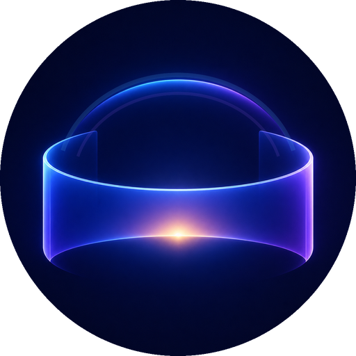

  
  <h1>Hoho 3D Player for Apple Vision Pro</h1>
  
<strong>Turn Everyday 2D Videos into Giant-Screen Immersive 3D in Real Time • Stream 8K VR180 & Spatial Video While Lying Flat</strong>

  

    
    
    
    
  

  

    <strong>English</strong> | <a href="README.zh-CN.md"><strong>简体中文说明</strong></a> | <a href="https://dvbs2000.github.io/hoho-player/support/">Support & FAQ</a> | <a href="https://dvbs2000.github.io/hoho-player/privacy/">Privacy Policy</a>
  

---

## Why Vision Pro Owners Choose Hoho 3D Player

Most Apple Vision Pro owners face three everyday frustrations:
1. **Not enough native 3D movies**—95% of your personal library, anime, concerts, and home videos are standard 2D files.
2. **Watching while lying down in bed is awkward**—panels pop up accidentally when your hand rests on the blanket, or you have to constantly recenter the screen when episodes change.
3. **Copying 40 GB+ 8K VR180 or MKV files into headset storage is painful**—and many players go silent on multichannel audio or fail to load embedded MKV subtitles.

**Hoho 3D Player** is engineered specifically for Apple Silicon on Vision Pro to solve all three.

---

## Key Capabilities & Experience Highlights

### 1. Real-Time On-Device AI 2D-to-3D + 500% Curved Wraparound Cinema
* **On-Device Neural Stereo Engine**: Converts standard 2D videos—movies, TV series, anime, live concerts, gameplay recordings, and family memories—into natural, comfortable stereoscopic 3D in real time. Even when you only have 2D files, you always have 3D to watch.
* **"Immersive 3D" Curved Cinema**: Hide your physical room and float a giant curved wraparound screen in pure space. Scale smoothly from **100% to 500%** (up to an immersive wraparound field of view) with soft optical feathered edges.
* **Customizable Depth & Brightness**: Choose between **3 AI 3D Depth Strength presets (`Gentle` / `Standard` / `Deep`)** and adjust **Immersive Screen Brightness (`40%–100%`)** on the fly for zero eye strain during long movie nights.
* **Rock-Solid Visual Stability**: Engineered with proprietary temporal stabilization, foreground edge preservation, and wide/aerial scene parallax control to eliminate depth flicker and boundary halos.

### 2. Native Spatial Video, Apple Immersive Video & 8K VR180 / 360°
* **All-In-One 3D & VR Formats**: Native playback for **Apple Spatial Video (`MV-HEVC`)**, **Apple Immersive Video (`AIVU`)**, **180° hemisphere (`VR180`)**, **360° panoramic video**, and **Full / Half Side-by-Side (`SBS`) & Top-Bottom (`TB`) 3D**.
* **Automatic Format Recognition + Instant Manual Override**: Automatically detects stereo packing and projection geometry on open, while allowing instant manual switching (`2D` / `3D` / `VR180` / `360°`) and Left/Right eye swap inside the player.

### 3. Engineered for Lying Down ("Ceiling Cinema") & Zero Distraction
* **Automatic Reclined Gaze Alignment**: When playback starts (including automatic playlist transitions) while looking upward past `35°`, the screen automatically aligns to your ceiling gaze. Sitting upright keeps a level horizon.
* **Independent Sitting & Reclined Height Memory**: Vertical screen offset is remembered separately for sitting and lying-down postures and restored automatically next time.
* **Reset View Without Losing Your Zoom**: Tapping *Reset View* recenters the screen to your current gaze while preserving your chosen `100%–500%` screen zoom and height offset.
* **Double-Tap Control Lock & Silent Transitions**: Enable **"Double-Tap to Show Controls"** (in the immersive bar or Settings) so slight hand movements never wake the control panel by accident. Automatic episode transitions keep your viewing angle without popping up the UI, and an **in-headset Playlist Drawer** lets you switch episodes without leaving immersion.

### 4. Direct NAS, Emby & Jellyfin Streaming + Headset-Off Background Downloads
* **Stream Without Copying Huge Files**: Built-in **SMB (`SMB2` / `SMB3`)**, **WebDAV**, **Emby**, and **Jellyfin** clients let you browse poster walls or folders (complete with watch progress bars, *"Watched"* badges, and a *"Continue Watching"* banner) and stream multi-gigabyte 8K files directly over Wi-Fi.
* **Keep Downloading After Taking Vision Pro Off**: WebDAV (`HTTPS`) downloads continue in the background even when you switch apps or take off your Vision Pro.
* **Broad Container, Audio & Subtitle Support**: Play `MP4`, `MOV`, `MKV`, `M4V`, `WMV`, `AVI`, `TS`, `M2TS`, and `WebM` with multichannel audio and **embedded MKV text subtitles (`SRT` / `ASS` / `SSA` / `WebVTT`)** or auto-matched external subtitles.

---

## Performance & Technical Specifications

| Specification | Hoho 3D Player (`v1.0.5`) |
| :--- | :--- |
| **AI 2D-to-3D Inference & Synthesis** | 100% On-Device Apple Neural Engine + Metal GPU (`< 13 ms` end-to-end frame latency) |
| **Supported AI 3D Resolution** | Compatible 2D videos up to **4K** (compatible HEVC videos up to **6K 60fps**) |
| **VR180 / 360° / Spatial Playback** | Hardware-accelerated up to **8K 10-bit HEVC** |
| **Color & Dynamic Range Pipeline** | Native **10-bit YCbCr / P3 Wide Color / HDR PQ** pipeline |
| **Curved Screen Scaling** | **100% – 500%** linear FOV zoom (portrait & landscape unlocked) + **40% – 100%** dimmer |
| **AI 3D Depth Presets** | **Gentle** / **Standard** / **Deep** real-time stereoscopic relief |
| **Privacy Architecture** | **Zero data collection**, zero analytics/trackers, 100% on-device processing |

---

## Supported Formats & Protocols Matrix

| Category | Supported Formats & Protocols |
| :--- | :--- |
| **Video Containers** | `MP4`, `MOV`, `MKV`, `M4V`, `WMV` / `ASF` *(unencrypted)*, `AVI`, `TS`, `M2TS`, `MTS`, `WebM` |
| **Video Codecs** | `HEVC (H.265 8-bit / 10-bit)`, `MV-HEVC (Spatial)`, `H.264 / AVC` *(including interlaced & >4K)*, `VP9`, `AV1`, `WMV1`, `WMV2`, `WMV3`, `VC-1`, `MS-MPEG4` |
| **Audio Codecs** | `AAC`, `AC-3`, `E-AC-3`, `MP3`, `MP1/MP2`, `FLAC`, `ALAC`, `Opus`, `WMA (WMAv1 / v2 / Pro / Lossless / Voice)`, `PCM / LPCM / ADPCM` |
| **3D & Immersive Modes** | `Real-Time AI 2D-to-3D`, `Immersive 3D Curved Cinema`, `Apple Spatial Video`, `Apple Immersive Video (.aivu)`, `180° VR180`, `360° Equirectangular`, `Full / Half SBS`, `Full / Half Over-Under (TB)` |
| **Subtitles** | Embedded MKV text subtitles (`SRT`, `ASS`, `SSA`, `WebVTT`), embedded MP4/MOV `tx3g`/`webvtt`, and external `.srt`, `.ass`, `.ssa`, `.vtt` (auto-matching same-name, language suffixes, and `Subs/` / `Subtitles/` subfolders with adjustable 3D subtitle depth) |
| **Network & Local Sources** | `SMB (SMB2 / SMB3)`, `WebDAV (HTTP / HTTPS + Background Downloads)`, `Emby`, `Jellyfin`, `System Photos Library (including iCloud Shared Albums)`, `Local Files / USB-C Drive` |

---

## Free Preview & Hoho Pro

* **Free Forever**:
  * All built-in sample videos (*2D Video*, *Spatial Video*, *Immersive Video*) play in full for free.
  * All of your own videos play in full in standard **2D** for free.
  * Every video includes a **free 2-minute 3D / AI 3D preview** so you can test format compatibility and 3D depth before subscribing.
* **Hoho Pro**:
  * Available as an **Annual Subscription (with a 3-day free trial)** or a **One-Time Lifetime Purchase**.
  * Unlocks unlimited 3D / AI 3D playback duration and all advanced immersive features.

---

## Open-Source Compliance & Notices

Hoho 3D Player uses a minimal, audio/video-decoder-only build of **FFmpeg (`libavcodec` / `libavutil` 7.1.1)** licensed under the **GNU Lesser General Public License (LGPL) v2.1** (compiled strictly with `--disable-gpl --disable-nonfree`) for legacy `.wmv` / `WMA` compatibility, alongside [`SMBClient`](https://github.com/kishikawakatsumi/SMBClient) (MIT License) for SMB2/SMB3 networking. Full license texts and build configurations are included inside the app under **Settings > About & Legal > Open-Source Licenses**.

---

## Feedback, Bug Reports & Support

* **GitHub Issues**: Found a bug, have a feature request, or encountered a video format that didn't play as expected? Please [open an Issue](https://github.com/dvbs2000/hoho-player/issues).
* **Email Support**: [sdicfund@hotmail.com](mailto:sdicfund@hotmail.com) (You can optionally attach a local diagnostic log via *Settings > Diagnostics* inside the app).
* **Support & FAQ**: [https://dvbs2000.github.io/hoho-player/support/](https://dvbs2000.github.io/hoho-player/support/)
* **Privacy Policy**: [https://dvbs2000.github.io/hoho-player/privacy/](https://dvbs2000.github.io/hoho-player/privacy/)

*Hoho 3D Player is an independent third-party application and is not affiliated with or endorsed by Apple Inc., Emby Media, or the Jellyfin project.*
